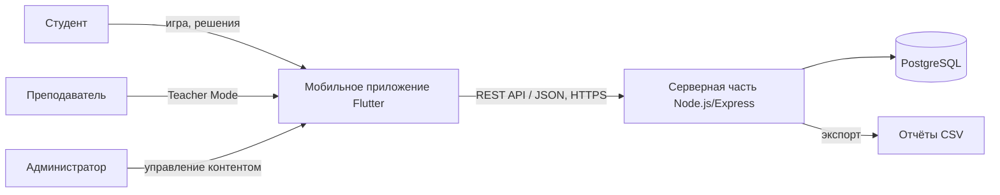
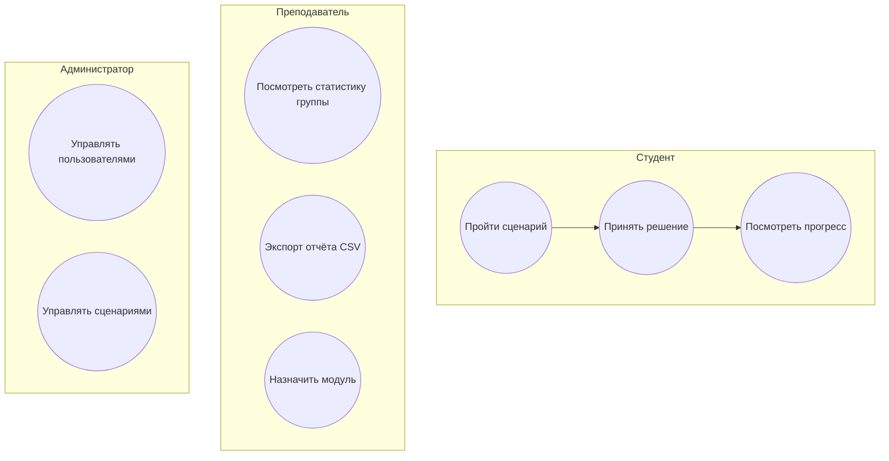
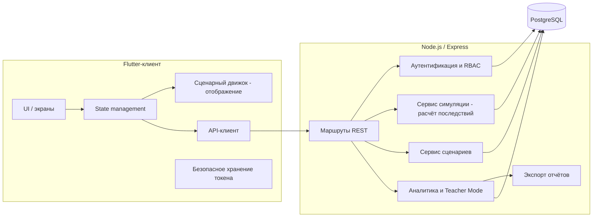
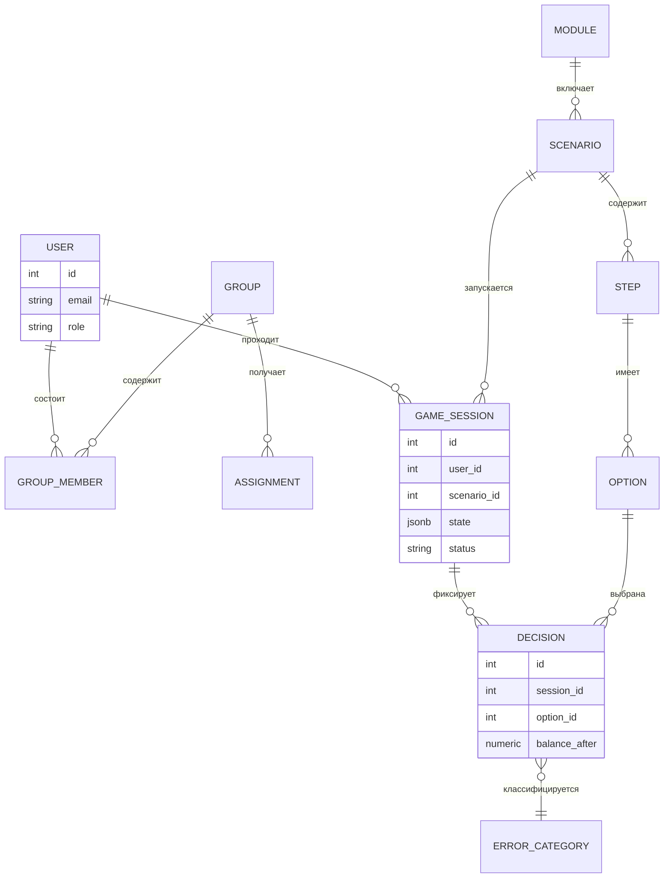

# 7. Архитектура и диаграммы

Исходники диаграмм в формате Mermaid лежат в [diagrams/](../diagrams/) и редактируются текстом. Диаграммы ниже отображаются на GitHub и GitLab; для предзащиты нужно приложить экспорт в PNG или SVG (через mermaid.live или `mmdc`).

## 7.1. Контекстная диаграмма системы

См. [diagrams/context.mmd](../diagrams/context.mmd).

## 7.2. Диаграмма вариантов использования

См. [diagrams/usecases.mmd](../diagrams/usecases.mmd).

## 7.3. Диаграмма компонентов (черновик)

См. [diagrams/components.mmd](../diagrams/components.mmd).

Разделение ответственности: клиент отображает состояние и отправляет выбор игрока; сервер рассчитывает показатели (NFR-4).

## 7.4. Модель данных (черновик)

См. [diagrams/er.mmd](../diagrams/er.mmd).

Модель данных отражает требования FR-8, FR-9 и FR-12: состояние сессии хранится, решения фиксируются, ошибки классифицируются.

## 7.5. Соответствие диаграмм требованиям

| Диаграмма | Требования |
|---|---|
| Контекст | Все роли, NFR-3 (HTTPS) |
| Use case | FR-1 … FR-13 |
| Компоненты | FR-9, NFR-4, NFR-8 |
| ER | FR-8, FR-9, FR-12 |
